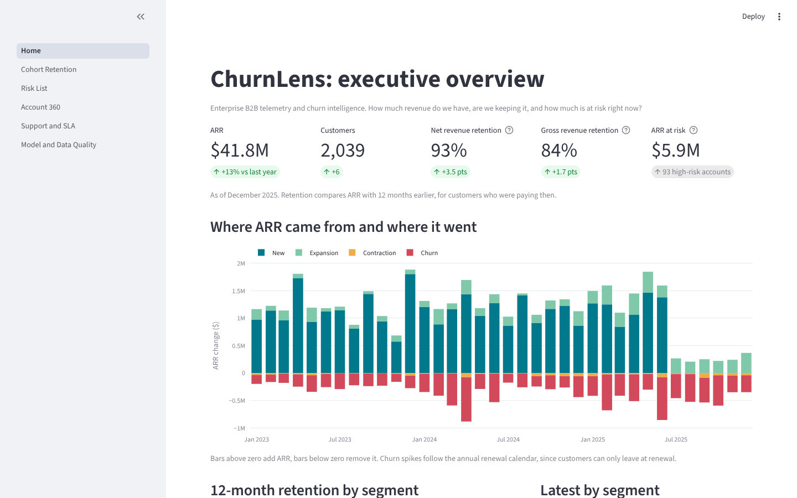
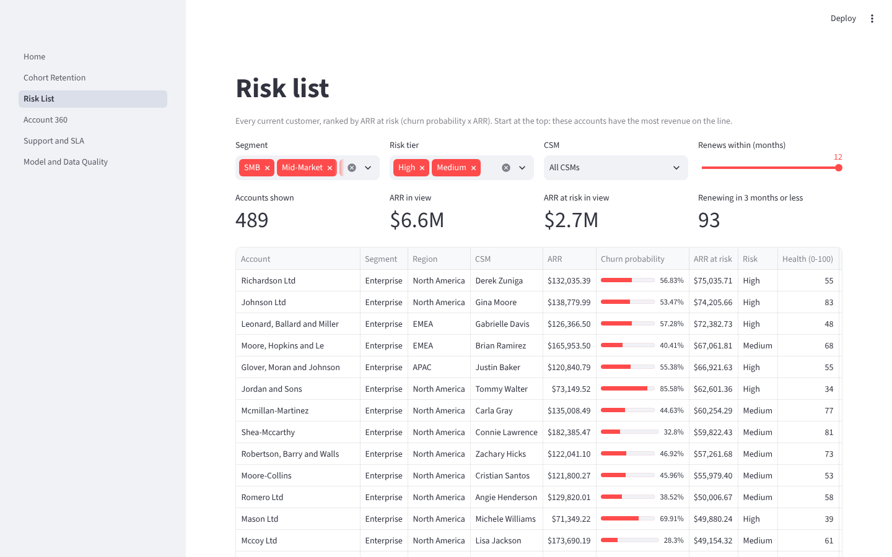
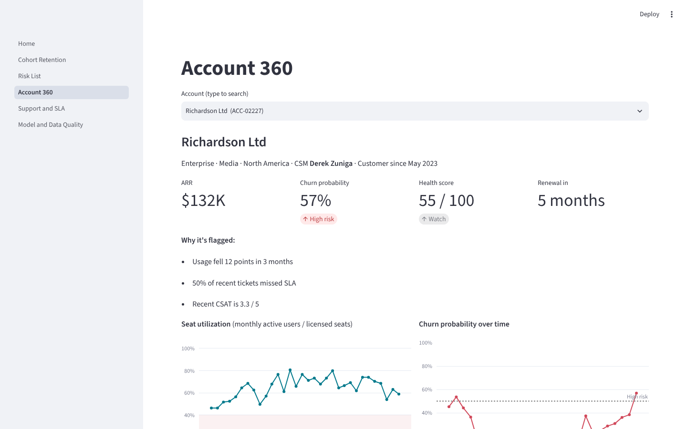
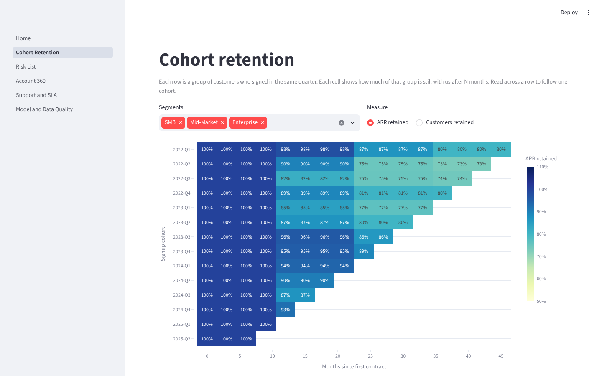
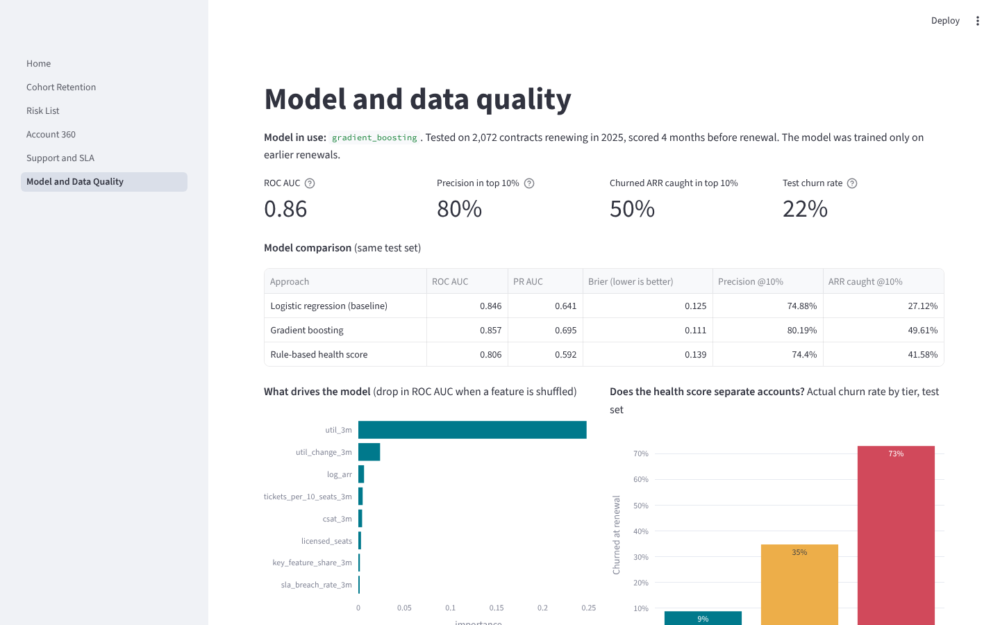

# ChurnLens

**Enterprise B2B Telemetry & Churn Intelligence Platform**

[](https://github.com/aadeniyi1/churnlens/actions/workflows/ci.yml)

**[▶ Live dashboard](https://churnlens-ade.streamlit.app/)** · **[Live API docs](https://churnlens-api-bber.onrender.com/docs)** · [API guide](docs/api_integration.md) · [Analysis notebook](analysis/retention_story.ipynb) · [Model card](docs/model_card.md) · [PRD](docs/prd.md) · [BRD](docs/brd.md) · [Workflows](docs/workflows.md)

ChurnLens is a working model of how a B2B SaaS company finds out which customer
accounts will renew, expand, or leave. It combines contracts, product usage, and
support history into one warehouse, scores each account's health, predicts churn
before the renewal date, and serves the results through an API and a live dashboard.

> **Work in progress.** Phases 1–6 are done: synthetic data, warehouse, retention analysis,
> churn model, dashboard, API, CI, and product docs. Polish and a video walkthrough come next.
> See [Roadmap](#roadmap).



All data is **synthetic**. It is generated by code in `generate/` and designed so
that the patterns are realistic: riskier accounts use the product less, file more
urgent tickets, and are more likely to churn.

---

## Quickstart

You need [uv](https://docs.astral.sh/uv/) installed. uv installs the right Python
version and every library for you.

```bash
git clone https://github.com/aadeniyi1/churnlens.git
cd churnlens
uv sync                     # installs Python 3.12 + all libraries into .venv/
uv run run.py all           # generate data, build the warehouse, check it, train the model
uv run run.py dashboard     # opens the dashboard in your browser (Ctrl+C to stop)
uv run run.py api           # starts the API; docs at http://127.0.0.1:8000/docs (key: dev-key)
uv run pytest               # runs the tests
```

These commands work the same in the macOS Terminal and in Windows PowerShell.

**Laptop busy or low on memory?** Make a smaller dataset:

- macOS / Linux: `CHURNLENS_ACCOUNTS=1000 uv run run.py generate`
- Windows PowerShell: `$env:CHURNLENS_ACCOUNTS=1000; uv run run.py generate`

With the default 3,000 accounts, generation uses well under 1 GB of RAM because
events are written one month at a time.

---

## What gets generated

| File in `data/raw/` | Pretend source system | Rows (default) |
|---|---|---|
| `accounts.parquet` | CRM: customers, segment, region, parent company | 3,000 |
| `csms.parquet` | CRM: customer success managers | 30 |
| `products.parquet` | Price book: plans and list price per seat | 3 |
| `contracts.parquet` | Billing: every contract and its renewal outcome | ~6,600 |
| `events/events_YYYY-MM.parquet` | Product telemetry, one file per month | ~1.7M total |
| `tickets.parquet` | Help desk: tickets, response times, CSAT | ~27,000 |
| `_truth/*.parquet` | Hidden answers (account risk). The pipeline never reads these. | |

The data also includes a little mess on purpose, so the cleaning step has real work:
duplicated events, stale copies of updated tickets, and missing CSAT scores.

---

## Key findings

From [analysis/retention_story.ipynb](analysis/retention_story.ipynb) (default dataset):

- **Growing, but leaking.** ARR grew to about $42M, but 12-month NRR is 93% and GRR is 84%. New sales are covering for a shrinking base.
- **SMB loses the most customers, Enterprise loses the most money.** 621 SMB customers churned, against 101 Enterprise customers who took about $7.4M of ARR with them.
- **Slow starts predict churn.** Customers using under 40% of their seats in the first 90 days churn at first renewal 34% of the time, against 15% for customers above 70%.
- **Churn is visible 6 months out.** In the last 6 months before renewal, churning customers use 40% of seats (renewing customers use 70%), file about 40% more tickets, and give lower CSAT (3.1 vs 3.7).

Metric definitions live in [docs/metrics.md](docs/metrics.md).

---

## Dashboard and churn model

`uv run run.py dashboard` opens a six-page Streamlit app:

| Page | For | Shows |
|---|---|---|
| Home | Executives | ARR, NRR, GRR, ARR at risk, the ARR waterfall, retention by segment |
| Cohort Retention | Analysts | Retention heatmap by signup quarter and segment |
| Risk List | CS leaders | Current accounts ranked by ARR at risk, with reasons and filters |
| Account 360 | CSMs | One account: hierarchy, contracts, usage trend, risk over time, tickets |
| Support and SLA | Support leads | SLA attainment, CSAT, and how missed SLAs relate to churn |
| Model and Data Quality | Data team | Model test results, feature importance, data freshness |

<table>
<tr>
<td><br><b>Risk List</b>: who to call this week, ranked by ARR at risk</td>
<td><br><b>Account 360</b>: why one account is flagged</td>
</tr>
<tr>
<td><br><b>Cohort Retention</b>: how each signup quarter holds up</td>
<td><br><b>Model and Data Quality</b>: how well the model tested</td>
</tr>
</table>

Every account gets two scores:

- **Health score (0–100)**, rule-based and explainable: 35% usage trend, 25% seat utilization,
  25% support experience, 15% contract signals.
- **Churn probability**, from a gradient boosting model trained only on data from 3+ months before each
  renewal and tested on later renewals: **ROC AUC 0.86**, and the riskiest 10% of accounts hold **50% of churned ARR**.

Details: [docs/model_card.md](docs/model_card.md). The live version runs at
**[churnlens-ade.streamlit.app](https://churnlens-ade.streamlit.app/)** (free hosting, so it may take
30 seconds to wake up). To deploy your own copy, follow [docs/deploy.md](docs/deploy.md).

---

## API

`uv run run.py api` starts a FastAPI service that lets other systems (a CRM, a Slack bot, a
nightly job) read the same scores as the dashboard. Interactive docs are at `/docs`.

| Endpoint | Returns |
|---|---|
| `GET /status` | Is it up, and which month the scores describe (no key needed) |
| `GET /v1/accounts` | Every account's churn risk, riskiest first, with filters and paging |
| `GET /v1/accounts/{id}` | One account: profile, current contract, score breakdown, reasons |
| `GET /v1/accounts/{id}/history` | Month-by-month ARR, usage, health and churn probability |
| `GET /v1/metrics/summary` | ARR, customers, NRR, GRR, ARR at risk |
| `GET /v1/metrics/retention` | 12-month NRR and GRR by segment |
| `GET /v1/model` | Which model is live and how it tested |

```bash
curl -H "X-API-Key: dev-key" "http://127.0.0.1:8000/v1/accounts?risk_tier=High&renewing_within_months=3&limit=5"
```

Every `/v1` call needs an `X-API-Key` header. [`examples/client.py`](examples/client.py) is a sample
"nightly CRM sync" that pages through every account and writes a CSV ready to import into a CRM.
[docs/api_integration.md](docs/api_integration.md) covers authentication, errors, and three
integration patterns. The live API runs for free on Render at
**[https://churnlens-api-bber.onrender.com/docs](https://churnlens-api-bber.onrender.com/docs)** (it sleeps when idle, so the first request can take a minute).
To deploy your own, see [docs/deploy.md](docs/deploy.md), Part 2.

---

## Product docs

| Document | For | What it covers |
|---|---|---|
| [PRD](docs/prd.md) | Product, engineering | Problem, personas, success metrics, requirements per module, roadmap for partner channel and CS playbooks |
| [BRD](docs/brd.md) | Business stakeholders | Objectives, business rules, benefits ($590K ARR if 10% of risk is saved), acceptance criteria |
| [Workflow maps](docs/workflows.md) | Everyone | 7 diagrams: data flow, Monday risk review, renewal timeline, reason → action, SLA escalation, release, CRM sync |
| [Metrics](docs/metrics.md) · [Data dictionary](docs/data_dictionary.md) | Analysts | Exact definitions of every metric and column |
| [Model card](docs/model_card.md) | Data team | How the churn model was trained and tested, and its limits |

---

## Automation

- **CI** ([`.github/workflows/ci.yml`](.github/workflows/ci.yml)): every push and pull request runs lint,
  builds the whole project from scratch on a 500-account dataset, and runs the tests.
- **Nightly pipeline** ([`.github/workflows/nightly.yml`](.github/workflows/nightly.yml)): rebuilds the full
  dataset at 06:00 UTC and republishes it to Supabase, which also keeps the free database awake.
  Needs a `SUPABASE_DB_URL` repository secret (see [docs/deploy.md](docs/deploy.md)).

---

## The warehouse

`uv run run.py build` turns the raw files into `data/warehouse.duckdb`, a star
schema with staging, dimension, fact, and mart layers, then runs 18 data quality
checks. If any check fails, the command exits with an error.

| Layer | Tables |
|---|---|
| Dimensions | `dim_account` (with parent/child hierarchy), `dim_product`, `dim_csm`, `dim_date` |
| Facts | `fact_contract`, `fact_arr_monthly`, `fact_usage_daily`, `fact_ticket` |
| Marts | `mart_account_month`, `mart_arr_bridge`, `mart_cohort_retention`, `metric_retention_12m` |

Every column is described in [docs/data_dictionary.md](docs/data_dictionary.md).
To explore it yourself, open it in the DuckDB CLI:

```bash
duckdb data/warehouse.duckdb -readonly
SELECT * FROM metric_retention_12m WHERE segment = 'All' ORDER BY month_start DESC LIMIT 5;
```

---

## Project layout

```
churnlens/
├── run.py            # one entry point: uv run run.py <command>
├── config.py         # every setting (sizes, seed, paths) in one place
├── generate/         # synthetic data: accounts -> contracts -> usage -> tickets
├── pipeline/         # SQL that builds the DuckDB warehouse, plus quality checks
│   └── sql/          # 01_staging -> 02_dimensions -> 03_facts -> 04_marts -> 05_metrics
├── analysis/         # retention_story.ipynb: the business findings, with charts
├── model/            # features, rule-based health score, churn model training and scoring
├── dashboard/        # Streamlit app: Home.py + pages/
├── api/              # FastAPI service: main.py (endpoints), db.py, schemas.py
├── examples/         # client.py: a sample integration that calls the API
├── docs/             # PRD, BRD, workflow maps, data dictionary, metrics, model card, API and deploy guides
├── tests/            # pytest checks
├── render.yaml       # how Render hosts the API
├── .github/workflows # CI on every change + nightly data refresh
└── data/             # generated, not committed (see .gitignore)
```

---

## Roadmap

- [x] **Phase 0:** project setup
- [x] **Phase 1:** synthetic accounts, contracts, usage, tickets
- [x] **Phase 2:** DuckDB star schema, ETL, data quality checks
- [x] **Phase 3:** ARR, NRR, GRR, and cohort retention analysis
- [x] **Phase 4:** health score, churn model, Streamlit dashboard
- [x] **Phase 5:** FastAPI service, example client, integration guide
- [x] **Phase 6:** GitHub Actions, PRD, BRD, workflow maps
- [ ] **Phase 7:** live demo ✅, screenshots ✅, video walkthrough
