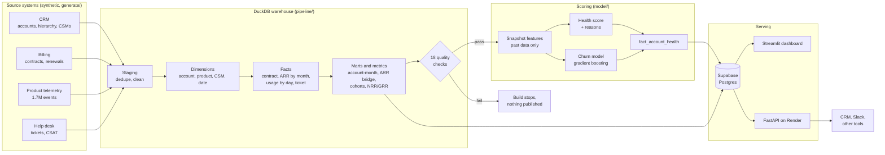
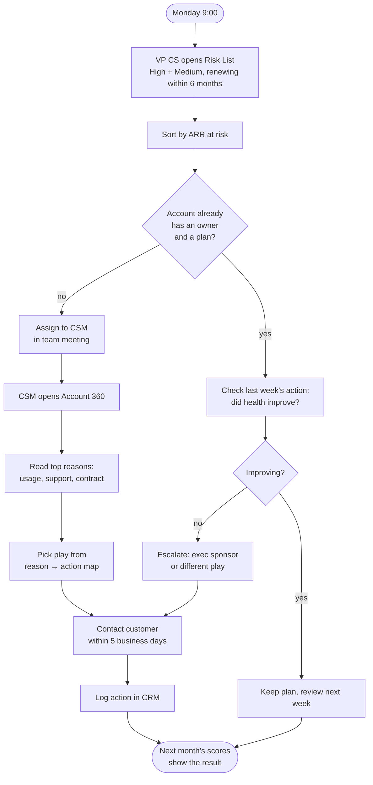
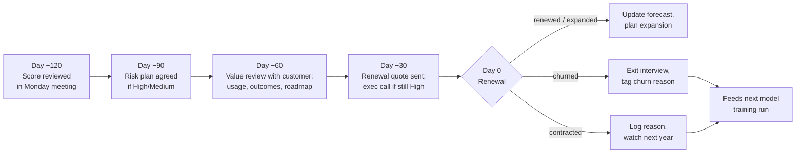
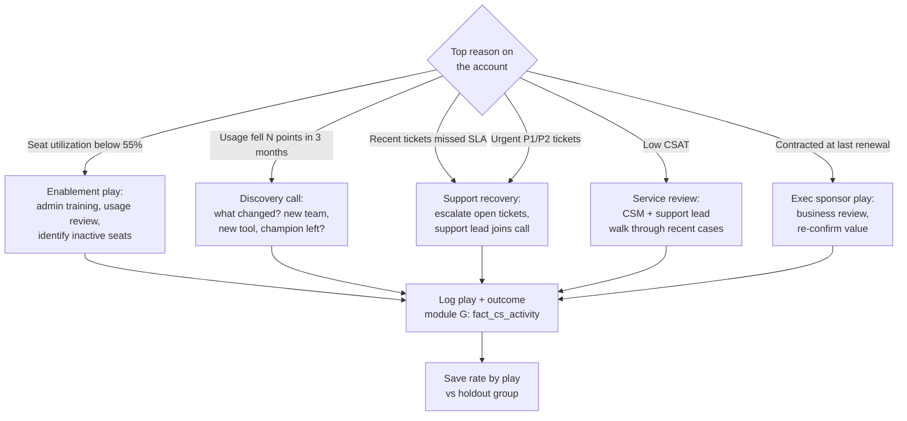
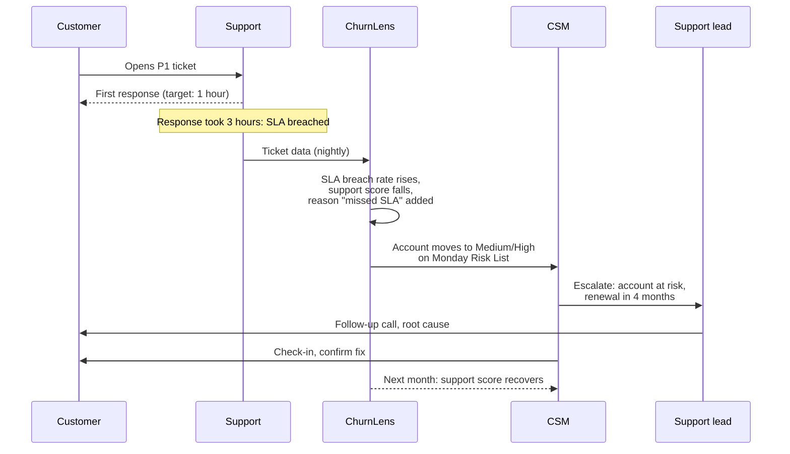
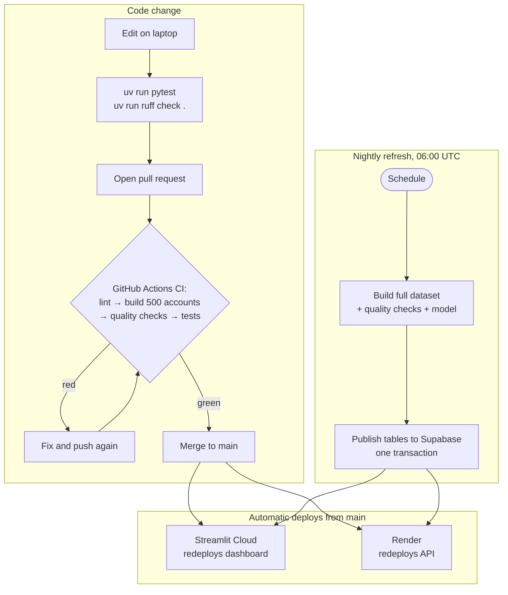
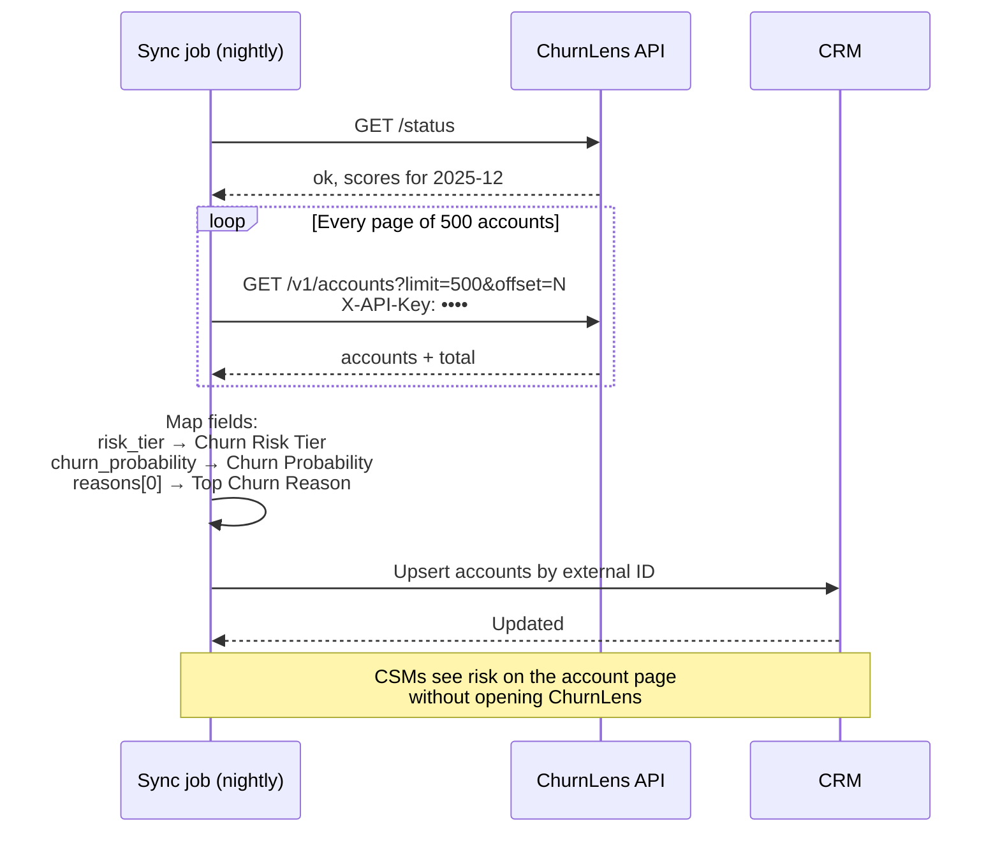

# Workflow maps

How data and people move through ChurnLens. GitHub draws these diagrams automatically from the
text (they're written in [Mermaid](https://mermaid.js.org/)). Click the ⧉ icon on a diagram to open it full size.

1. [System data flow](#1-system-data-flow): from source systems to dashboard and API
2. [Monday risk review](#2-monday-risk-review): how CS uses the Risk List each week
3. [Renewal timeline](#3-renewal-timeline): what happens 120 days before a renewal
4. [Risk reason to action](#4-risk-reason-to-action): which play fits which reason (module G preview)
5. [Support SLA escalation](#5-support-sla-escalation): when a support problem becomes a churn risk
6. [Pipeline and release](#6-pipeline-and-release): how a code change and a nightly refresh reach production
7. [Integration: nightly CRM sync](#7-integration-nightly-crm-sync): how another system pulls scores through the API

---

## 1. System data flow

## 2. Monday risk review

## 3. Renewal timeline

The model is trained on snapshots taken 90+ days before renewal, so the first useful flag arrives
around day −120. Each step below is a checkpoint the CSM owns.

## 4. Risk reason to action

This is the core of module G (CS playbooks, roadmap). In v1 the CSM picks the play by hand from
this map.

## 5. Support SLA escalation

## 6. Pipeline and release

## 7. Integration: nightly CRM sync

What `examples/client.py` does, and what a real Salesforce or HubSpot sync would do.

